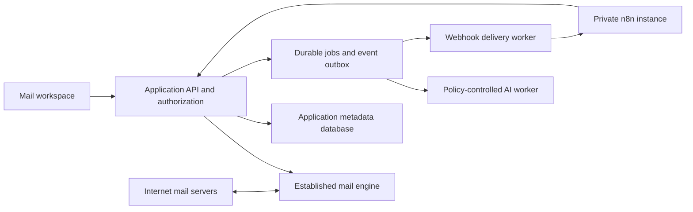

# Product and architecture brief

Draft, 18 September 2026. This document describes the intended wider product. An initial application now exists; see [implementation status](status.md) for completed behavior, limitations, and unverified integrations.

## Confirmed requirements

- Ubuntu server with Docker.
- Initial deployment serves the owner's businesses and team with 3 domains and 10 mailboxes. Allow growth to the owner's 10 domains without a redesign; these initial counts are not hard-coded product limits. Resale uses a separate Docker installation for each customer, with independent storage, credentials, and configuration.
- User confirms DNS control, a static public IP, configurable reverse DNS, and inbound/outbound port 25. Verify actual connectivity during deployment.
- Both hosted domains/mailboxes and connected Gmail, Microsoft, and IMAP accounts.
- Private by default. External AI requires explicit opt-in per mailbox. AI-generated replies require human approval before sending.
- Mailbox-level permissions still apply within the organization; owning several businesses does not give every user access to all mailboxes.

## Product scope

Deliver a privately hosted mail service and Gmail-style workspace for people operating several businesses or shared mailboxes. Use an established mail engine for delivery and storage. Build the workspace, permissions, integration API, and controlled AI assistance around it.

### Mail experience

- Unified inbox with explicit account and organization filters; separate per-account inboxes.
- Threaded conversations, keyboard navigation, accessible responsive layouts, bulk actions, attachment previews, and full-text search.
- Folders, nested folders, labels, favorites, customizable mailbox ordering, saved searches, unread and priority views.
- Compose, reply, reply-all, forward, drafts, per-identity signatures, templates, scheduled sending, delayed-send cancellation, snooze, and follow-up reminders.
- Preserve sender identity when replying; visibly identify the mailbox and From address. Revalidate send-as permissions at submission time.
- Shared mailbox assignments, internal notes, collision warnings, and action history. Internal notes must never become outgoing message content.
- Confirmed scope: host our own domains and mailboxes, and connect existing Gmail, Microsoft, and IMAP accounts in the same workspace.

### Administration

- Domains, DNS verification, users, mailbox quotas, groups, aliases, send-as grants, and delegated mailbox access.
- Alias routing and send-as authorization are separate controls. An alias is an address pointing to delivery targets, not automatically a separate login or mailbox.
- Catch-all disabled by default; forwarding requires destination verification, loop detection, and abuse limits.
- Roles: platform administrator, organization administrator, mailbox owner, delegated reader, delegated sender, automation identity.
- Separate platform operations from mail-content access. Any support access must be explicit, time-limited, and audited.
- Delivery queues, bounce diagnostics, domain authentication status, storage alerts, backup status, and integration health.
- Migration with resumable imports, duplicate detection, progress reports, and source-to-destination folder mapping.

## Proposed architecture

Mail engine owns message storage, delivery, and protocol state. The application owns organization membership, delegation, assignments, integration grants, audit history, and automation policy. Avoid competing authoritative copies of messages; reconcile cached state after missed events.

Stalwart is a candidate because of its JMAP interface. Each customer will have a separate mail-engine deployment serving that customer's domains and team. Shared-engine customer tenancy is outside the confirmed scope, so Enterprise tenant isolation is not a requirement solely for resale. Review the selected edition's features and distribution terms before committing to it. Application framework remains provisional.

### Separate customer installations

Organization identity must be derived from authenticated membership and grants, not trusted directly from a request parameter. Scope domain ownership, accounts, messages, provider credentials, search indexes, attachments, jobs, caches, audit events, webhook subscriptions, and AI context to the organization. Validate that domains cannot be claimed by another organization without a controlled ownership-transfer process.

Package one Docker Compose stack per customer with its own mail engine, application, database, workers, private networks, volumes, encryption keys, OAuth configuration, API credentials, and backup destination or independently authorized backup namespace. Generate secrets at installation; never clone live credentials or mail data into a customer template. Keep deployment identity explicit in jobs and integrations. Test mailbox authorization within each installation and credential rejection between two separate test installations. Background workers must revalidate mailbox grants at execution time.

Prefer a dedicated Ubuntu host or VM per customer. Separate Compose projects on one host share the host kernel and are not equivalent to VM isolation. Public SMTP listeners also require an explicit IP and routing plan if customers share a host. Do not expose databases, share Docker sockets, or mount another customer's volumes into application containers.

Provide versioned images, installation configuration, health checks, upgrades with migration safeguards, backups, restores, and documented rollback limits. Each installation must work independently; any future central licensing, fleet management, telemetry, or support access is a separate product decision. No default reseller access to customer mail.

Support organization export, retention, quota enforcement, suspension, and eventual removal without affecting other organizations. Billing and customer self-service scope remain unconfirmed. Review dependencies' distribution and commercial-use terms for the selected resale model. Integrating with a customer's n8n instance and bundling or reselling n8n are separate licensing decisions; bundling is not currently assumed.

Confirmed production deployment: Ubuntu server with Docker. Proposed packaging uses Docker Compose with separate mail-engine, application, database, and worker services, persistent volumes, HTTPS ingress, isolated internal networks, and separately configured SMTP connectivity. The local Windows workspace is for development.

### Connected accounts

Provide provider adapters for Gmail, Microsoft, and generic IMAP with authenticated SMTP submission. Prefer provider-supported OAuth for Google and Microsoft; keep tokens encrypted server-side and request only necessary permissions. Provider app registration and any required consent verification are deployment prerequisites.

Preserve each provider as the source of truth for connected mail. Track provider IDs, synchronization cursors, folder/label mappings, and capabilities per account. Support initial import, incremental synchronization, reconnects, rate limits, expired authorization, and reconciliation after missed events. Avoid promising identical label/folder semantics across providers.

Send through the selected account's authorized provider transport. Never assume that hosting a domain grants permission to send as a connected external identity. Distinguish account disconnection from deletion of mail at the provider. Expose synchronization failures and unsupported operations clearly in the workspace.

## Integration API

Versioned API with an OpenAPI contract, cursor pagination, explicit errors, quotas, request correlation IDs, and idempotency for submissions and provisioning. Proposed resources:

| Resource | Operations |
| --- | --- |
| Domains and accounts | Verify domains, provision accounts, manage quota and membership |
| Mailboxes and folders | List, create, rename, order, and apply grants |
| Messages and threads | Search, read, label, move, archive, trash, and retrieve attachments |
| Drafts and submissions | Create drafts, request approval, submit, schedule, and inspect status |
| Aliases and identities | Configure routing and explicitly grant send-as access |
| Rules and jobs | Preview matching, enable rules, inspect executions, and retry safely |
| Webhook subscriptions | Register endpoints, choose events, rotate secrets, and inspect delivery |

Separate scopes such as messages:read, messages:write, drafts:write, mail:send, aliases:manage, and domains:manage. Bind every grant to permitted organizations and mailboxes. Enforce access on search results, attachment downloads, background jobs, and every object lookup, not only navigation. Never distribute a platform administrator credential to n8n or an AI provider.

Webhook events include message.received, message.updated, draft.created, submission.accepted, submission.failed, and alias.updated. Submission acceptance must not be described as recipient delivery. Use an event ID, schema version, timestamp, actor, organization, mailbox, and minimal resource references. Message bodies and attachments are excluded by default.

Use signed webhook payloads with timestamps, replay protection, exponential retries, dead-letter inspection, secret rotation, and documented at-least-once delivery. Consumers deduplicate by event ID. Outgoing destination validation must resist SSRF, redirects, and DNS rebinding. Explicitly allowlist required private n8n endpoints while continuing to block cloud metadata and unrelated internal services.

## AI and n8n

- AI features: classify, suggest labels, summarize threads, extract tasks, identify follow-ups, and draft replies.
- Confirmed policy: private by default; AI disabled until a mailbox policy is configured, external AI explicitly enabled per mailbox, and AI-generated replies require human approval before sending. Local and external providers use the same authorization boundary. Approval must bind to the reviewed message content, recipients, attachments, and sending identity; subsequent changes invalidate it.
- Email text and attachments are untrusted data. Instructions inside a message cannot grant tools, change policies, retrieve other mailboxes, or authorize sending.
- Limit context to authorized content, record which messages informed a draft, expose reviewable suggestions, and revalidate permissions before applying actions.
- Explicit external-provider opt-in per mailbox, attachment opt-in, configurable retention and redaction, budgets, and bounded execution times. Local AI does not imply end-to-end encryption.
- n8n calls the scoped API; examples to implement include invoice labeling, lead assignment, draft suggestions, alias provisioning, and unanswered-message reminders.
- Separate integration credentials by workflow purpose. Keep email bodies and secrets out of execution logs by default; configure workflow history retention and pruning.
- AI-generated replies cannot be sent automatically under the confirmed policy, including through n8n or an API token. Any future autonomous-send feature requires a deliberate policy change. Retries must not blindly resubmit mail when delivery status is uncertain.

## Security and operational requirements

- MFA for privileged users, secure session cookies, CSRF protection, login throttling, session revocation, and short-lived privileged access.
- Encrypted disks and backups, managed encryption keys, secret rotation, and protected provider tokens. Document that server-side search and AI require server-readable content; this is not end-to-end encryption.
- Sanitize message HTML, render it in an isolated sandbox with restrictive CSP, block remote tracking images by default, disallow executable content, and scan attachments. Any remote-content proxy requires SSRF defenses.
- Enforce authenticated submission and reject unauthorized relay. Apply per-account and per-domain sending limits and monitor compromised accounts, spam, and queue growth.
- Configure MX, SPF, DKIM, DMARC, forward/reverse DNS, certificates, and delivery monitoring. Validate provider port-25 policy and IP suitability; support an authenticated outbound relay if needed. Authentication records do not guarantee inbox placement.
- Private administration and databases, least-privilege service identities, pinned release artifacts, vulnerability checks, updates with rollback, and protected audit logs without message-body logging.
- Automated encrypted off-host backups of messages, metadata, configuration, and recoverable keys; perform restore drills and define recovery time and acceptable data loss with the operator.
- User-configurable retention, trash recovery, deletion/export behavior, and expiration of derived AI/search data. Define backup expiry separately.

## Delivery sequence and acceptance

1. Use the confirmed Ubuntu/Docker, 3-domain, 10-mailbox scope and separate-installation resale model. Select the mail engine and licensing model; defer exact server sizing until measured resource requirements are available. Migration details can be gathered before importing live mail.
2. Deliver a working vertical slice: login, one verified test domain, two users, an alias, inbound mail, folder operations, and authorized reply. Verify unauthorized users cannot read or send as another account.
3. Add unified multi-account views, administration, delegation, search, signatures, scheduling, and migration.
4. Deliver the documented API and a runnable n8n example. Verify duplicate events and retried jobs do not create duplicate actions; revoked grants stop subsequent executions.
5. Add controlled AI sorting and draft assistance. Test prompt-injection messages, cross-mailbox retrieval attempts, and blocked sends without approval.
6. Validate backups/restores, outage recovery, malicious HTML/attachments, open-relay rejection, DNS/TLS configuration, realistic performance, and deployment procedures before production use.

Do not mark a mock interface, unconnected integration, or generated deployment file as a working mail service.

## Open decisions

- Ubuntu/Docker, DNS control, static public IP, reverse-DNS control, and inbound/outbound port 25 availability are confirmed by the user; provider, server capacity, and deployment-time verification remain open.
- Initial scope is 3 domains and 10 mailboxes. User count, storage volume, and traffic remain unspecified and do not block initial implementation. Do not equate mailbox count with user count.
- Both hosted accounts and external Gmail/Microsoft/IMAP aggregation are confirmed.
- Initial use is the owner's businesses/team; resale is confirmed as a separate Docker installation per customer. Team size and delegation requirements remain open.
- Private-by-default AI with per-mailbox external opt-in and human approval for AI replies is confirmed; provider choice and retention details remain open.
- Existing n8n instance, licensing budget, preferred stack, migration sources, calendars/contacts, mobile needs, and recovery targets.

## Sources checked

- [Stalwart JMAP](https://stalw.art/docs/http/jmap/)
- [Stalwart tenant isolation and edition restriction](https://www.stalw.art/docs/auth/authorization/tenants/)
- [Stalwart edition comparison](https://www.stalw.art/compare/)
- [n8n security audit](https://docs.n8n.io/hosting/securing/security-audit/)
- [OWASP HTML5 security guidance](https://cheatsheetseries.owasp.org/cheatsheets/HTML5_Security_Cheat_Sheet.html)
- [Google sender guidelines](https://support.google.com/mail/answer/81126?hl=en-GB)
